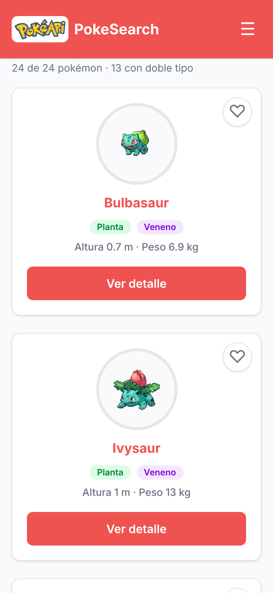

# PokeSearch · Explorador interactivo de Pokémon


**Pruébalo aquí:** https://TU-PROYECTO.vercel.app

Es un explorador de Pokémon hecho con los datos reales de la PokéAPI. Puedes buscar por nombre, filtrar por tipo, ver el detalle de cada uno en una ventana, cargar más Pokémon y guardar tus favoritos, que se quedan guardados aunque cierres el navegador.

- **API:** [PokéAPI](https://pokeapi.co) (`/api/v2/pokemon`), sin clave.
- **Tecnologías:** HTML semántico, Tailwind CSS v4 (CLI), JavaScript con módulos ES, `fetch` con `async/await`, `Promise.all` y LocalStorage.
- **Hecho por:** Sebastian Herrera Rueda · Tecnología en Sistemas Informáticos · Universidad de Caldas · Programación para Entornos Web I (2026-2).

## Qué puedes hacer

- Ver los primeros 24 Pokémon y cargar 24 más con el botón «Cargar más».
- Buscar por nombre (sin importar mayúsculas ni espacios) y filtrar por cualquiera de sus tipos.
- Abrir el detalle de un Pokémon: número, tipos, altura, peso y habilidades.
- Marcar favoritos con el ♡ y verlos en la vista «Favoritos», incluso sin internet.
- Si la API falla, sale un mensaje con el motivo y un botón para reintentar. Si la búsqueda no encuentra nada, también te avisa.
- Se ve bien en celular y en escritorio, y tiene modo oscuro automático.

## Cómo correrlo en tu computador

```bash
git clone https://github.com/SebastianH204/Proyecto.git
cd Proyecto
npm install
npm run dev
```

Deja esa terminal abierta (genera `css/tailwind.css` y lo actualiza cada vez que guardas) y abre `index.html` con Live Server. Con doble clic no funciona, porque los módulos de JavaScript necesitan abrirse por `http://`.

## Scripts

| Comando | Qué hace |
|---|---|
| `npm run dev` | Compila Tailwind y lo vuelve a compilar cada vez que guardas |
| `npm run build` | Compila Tailwind una vez y minificado (lo usan el CI y Vercel) |
| `npm run validar` | Revisa `index.html` con html-validate |

## Estructura

```text
index.html            la página: header, buscador, resultados, modal y footer
src/entrada.css       entrada de Tailwind: @import "tailwindcss";
css/tailwind.css      lo genera npm run dev / build (no se sube a Git)
js/app.js             la interfaz: estado, render y eventos
js/api.js             fetch a la PokéAPI y manejo de errores
js/logica.js          funciones puras: filtrar, contar y buscar
js/favoritos.js       guardar y leer favoritos en LocalStorage
img/favicon.svg       el ícono de la pestaña
docs/                 notas de la API, bitácora de IA y capturas
```

## Flujo de trabajo

Cada cambio entra a `main` por una rama y un Pull Request. GitHub Actions compila Tailwind y valida el HTML en cada PR, y Vercel publica una preview por PR y la versión de producción con cada merge a `main`.

## Capturas




